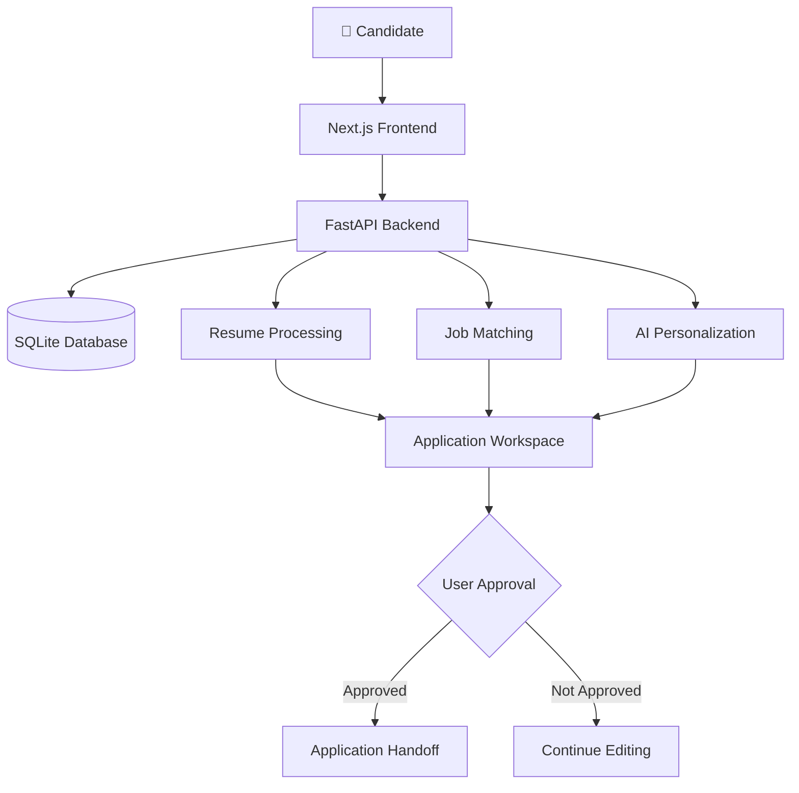

<!--
  JobZen — GitHub README
 
-->

<div align="center">


### An AI-powered job application platform

Discover opportunities. Understand your fit. Personalize your applications. Stay organized.

<br/>


<br/><br/>

**Built to make job searching smarter, more organized, and more personalized.**

</div>

---

## ✨ About JobZen

Job hunting often means searching across multiple platforms, tailoring resumes repeatedly, writing cover letters, and tracking applications manually.

**JobZen aims to bring that workflow into one place.**

It is a full-stack project designed to help candidates discover relevant opportunities, understand how their profiles align with job requirements, prepare tailored application materials, and manage their progress from a centralized dashboard.

The goal is to combine AI-assisted personalization with a simple principle: **the candidate stays in control.**

## 🚀 Key Features

| Feature | What it does |
|---|---|
| 🔎 Job Discovery | Explore opportunities that align with your skills, interests, and preferred roles. |
| 🎯 Job Match Analysis | Compare candidate profiles with job requirements and identify potential skill gaps. |
| 📄 Resume Management | Upload and manage resumes for a more organized application workflow. |
| ✍️ AI-Assisted Personalization | Plan tailored resumes and cover letters for individual opportunities. |
| 📊 Application Tracker | Organize applications and monitor their statuses in one dashboard. |
| 🛡️ Human Approval | Require explicit user approval before an application is submitted. |

> **Development note:** JobZen is a work in progress. Features listed here describe the intended product; availability depends on the current implementation.

## 🖥️ Technology Stack

<div align="center">


<br/>


</div>

| Layer | Technology | Purpose |
|---|---|---|
| Frontend | Next.js, React, TypeScript | User interface and application experience |
| Styling | Tailwind CSS | Responsive, consistent interface styling |
| Backend | Python, FastAPI | API layer and application logic |
| Database | SQLite (planned/local persistence) | Store profile and application information |

## 🏗️ High-Level Architecture



The intended workflow separates the user interface, backend services, data storage, and AI-assisted tasks. External job providers and application submission integrations will depend on future implementation.

## 🔄 How It Works

1. **Build your profile** — add skills, experience, preferred roles, and career goals.
2. **Manage your resume** — upload your resume and review the extracted information.
3. **Explore opportunities** — identify jobs relevant to your professional profile.
4. **Evaluate your fit** — compare your experience and skills against job requirements.
5. **Personalize your application** — prepare role-specific resume and cover-letter drafts.
6. **Review and approve** — inspect the materials and explicitly approve each application.
7. **Track progress** — maintain a centralized record of application statuses.

## 💻 Getting Started

### Prerequisites

- [Node.js](https://nodejs.org/) and npm
- [Python](https://www.python.org/) for the backend
- [Git](https://git-scm.com/)
- [Visual Studio Code](https://code.visualstudio.com/) (recommended)

### 1. Clone the repository

```bash
git clone git clone https://github.com/Shreepriya20/jobzen.git
cd jobzen
```


### 2. Run the frontend

```bash
npm install
npm run dev
```

Open [http://localhost:3000](http://localhost:3000).

### 3. Run the backend

The backend setup depends on the Python source files and dependency configuration committed to the repository. Once those files are included, follow the backend-specific installation instructions.

For local development, the API is intended to run at:

`http://127.0.0.1:8000`

API documentation, when the FastAPI server is running:

`http://127.0.0.1:8000/docs`

## 🔐 Privacy & Responsible Automation

JobZen is being designed around user control and responsible automation.

- **Human in the loop:** applications should not be submitted without explicit approval.
- **Data protection:** exclude uploaded resumes, local databases, environment files, and credentials from source control.
- **Transparent matching:** explain why a job may or may not fit a candidate's profile.
- **Responsible integrations:** use supported job sources and respect third-party platforms' terms and access policies.

These are project goals; actual protections depend on the implemented features and deployment configuration.

## 🗺️ Roadmap

- [x] Initial Next.js frontend
- [x] Initial FastAPI health-check integration
- [ ] Persistent candidate profile management
- [ ] Reliable resume upload and text extraction
- [ ] Job discovery integrations
- [ ] Resume-to-job matching and explainable scoring
- [ ] AI-generated resume and cover-letter drafts
- [ ] Approval workflow before submission
- [ ] Complete application tracking
- [ ] Automated job-alert ingestion
- [ ] Testing, deployment, and security hardening

## 🎯 Vision

The long-term vision is to create a personal job-search workspace that reduces repetitive work while helping candidates make better-informed career decisions.

**Less manual effort. More relevant applications. Complete control.**

---

<div align="center">


<sub>JobZen · AI-assisted job applications · Built with care</sub>

</div>
